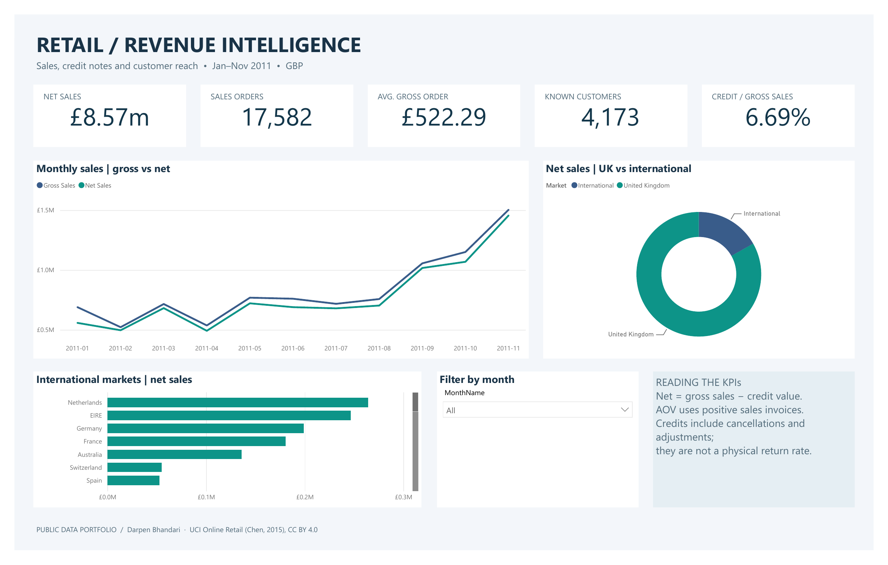
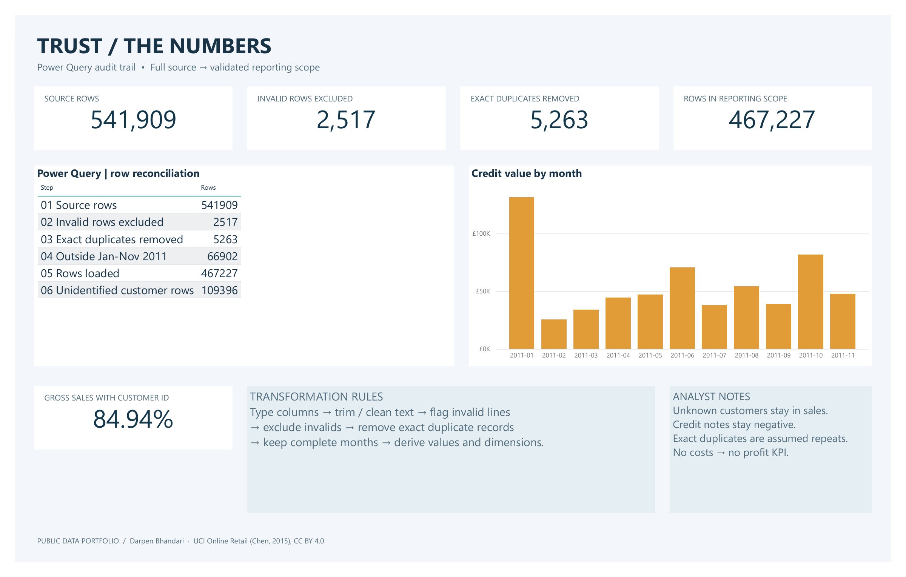
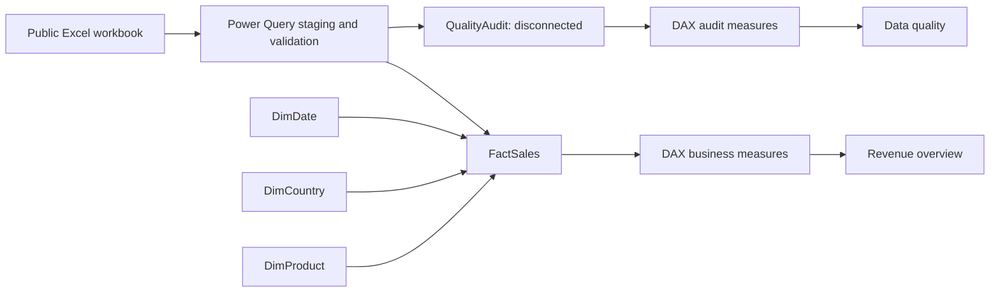

# Retail Revenue Intelligence · Power BI + Power Query

A public-data portfolio project that turns a historical transaction workbook into
an interactive revenue report and a visible data-quality audit.



The image above is rendered from the actual Power BI Desktop PDF export.
The native report uses interactive Power BI visuals.

## Open the dashboard

For the quickest start, download and open **[RetailRevenue.pbix](RetailRevenue.pbix)**.
It contains the populated model and both report pages. To refresh it on another
computer, change `SourceFile` in **Transform data > Manage Parameters** to your
local copy of the included workbook.

For the source-controlled project:

1. Clone or download this repository.
2. Install a current Power BI Desktop release with Power BI Project support.
3. Run `python scripts/configure_source.py` to point the Power Query parameter at
   the included `data/raw/Online Retail.xlsx` file. Close the report before changing
   its source files externally.
4. Open **[RetailRevenue.pbip](RetailRevenue.pbip)** in Power BI Desktop and select **Refresh**.
5. Use the month slicer, chart selections, and the two report pages.

Power BI Desktop handles the import locally; no API keys, database server, Python
integration in Power BI, or paid cloud service is required. Python is used only
for independent QA and reference preview rendering.

## Report pages

| Page | Questions it answers |
|---|---|
| Revenue overview | How do gross/net sales change by month? How much is domestic versus international? Which international markets lead? |
| Data quality | Which records were excluded? How many duplicates were removed? How much sales value has customer attribution? |



Share the **[two-page PDF](RetailRevenue.pdf)** as a LinkedIn document, or use the
native PNG exports above. The separately labelled `*-preview.png` images are
independent reference renders and are not Power BI exports.

## Verified full-period metrics

Historical reporting scope: **1 January–30 November 2011**, in **GBP**.
December 2011 is incomplete in the source and is excluded. December 2010 is also
excluded to keep one consistent eleven-month reporting period.

| KPI | Definition | Verified value |
|---|---|---:|
| Gross sales | Positive-quantity line value | £9,182,867.74 |
| Credit value | Absolute value of negative-quantity lines | £614,161.34 |
| Net sales | Gross sales minus credit value | £8,568,706.40 |
| Sales orders | Distinct invoices with positive-quantity lines | 17,582 |
| Average gross order value | Gross sales / sales orders | £522.29 |
| Known customers | Distinct identified customers with a sales line | 4,173 |
| Credit-value ratio | Credit value / gross sales | 6.69% |
| Identified sales share | Gross sales associated with a customer ID / gross sales | 84.94% |

These are descriptive historical totals, not forecasts, profit measures, or
current business results. Credit notes include cancellations and adjustments;
the credit-value ratio is **not a physical product return rate**. Orders and AOV
include positive-priced service/charge lines present in the source.

## What Power Query does

The semantic model executes the M code in Power BI. Separate `.pq` files make the
same logic easy to inspect, learn from, and copy into Advanced Editor.

1. **RawRetail:** import the Excel sheet and assign explicit data types with an
   `en-GB` culture; keep identifiers as text and prices as fixed-decimal currency.
2. **PreparedRetail:** clean/trim text, standardize key casing, replace missing
   customer IDs with `Unknown`, fill missing descriptions, and add validation status.
3. **ScopedRetail:** exclude invalid rows, remove exact duplicate records, and
   filter to the complete-month reporting period.
4. **FactSales:** derive date, sale/credit classification, gross, credit, and net values.
5. **Dimensions:** build date, country/market, and deterministic product-name lookups.
6. **QualityAudit:** reconcile all row exclusions and count unidentified customers.

| Reconciliation | Rows |
|---|---:|
| Source | 541,909 |
| Invalid lines excluded | −2,517 |
| Exact duplicate records removed | −5,263 |
| Outside reporting period | −66,902 |
| Reporting rows | **467,227** |

Unknown customer rows are **retained**, not counted as invalid. Exact identical
records are assumed to be repeated records; the data lacks a unique line ID, so
this is an explicit modeling assumption rather than proven source corruption.
See [transformation rules](docs/transformation-rules.md).

## Model and measures



Relationships use single-direction dimension-to-fact filtering. `QualityAudit` is
disconnected so business slicers do not rewrite the source audit. Product labels
use an alphabetically selected description per stock code; raw descriptions can
vary. DAX measures are in [dax/measures.dax](dax/measures.dax).
Presentation-only text measures enforce readable KPI formatting with an explicit
`en-GB` locale; the numeric measures remain the basis for calculations and charts.

## Project files

| Path | Contents |
|---|---|
| `RetailRevenue.pbip` | Native Power BI Project entry point |
| `RetailRevenue.pbix` | Populated native report for immediate viewing |
| `RetailRevenue.pdf` | Native two-page PDF export for sharing |
| `RetailRevenue.Report/` | PBIR report pages and native visual definitions |
| `RetailRevenue.SemanticModel/` | Import model, relationships, measures, and M queries |
| `power-query/` | Readable M scripts, including source parameter |
| `data/raw/` | Attributed, unmodified public workbook |
| `docs/verified-metrics.json` | Independent metric totals and workbook SHA-256 |
| `scripts/verify_data.py` | QA mirror that checks row/amount reconciliation |
| `scripts/render_previews.py` | Recreates the labelled reference images |
| `docs/linkedin-post.md` | Ready-to-adapt LinkedIn caption |

## Reproduce the checks

```bash
python -m pip install -r requirements-dev.txt
python scripts/verify_data.py
python scripts/render_previews.py
python scripts/validate_report.py
```

The Python check validates row reconciliation, retained date bounds, eleven months
of coverage, non-positive price exclusion, duplicate removal, and the gross-minus-
credit identity. It does not substitute for refreshing the Power Query model in
Power BI. Native report schema files were also checked against Microsoft's PBIR
JSON schemas during creation.

## Native validation

Validated in Power BI Desktop Store version **2.159.883.0** on 27 October 2026:
all five loaded tables refreshed successfully, the audit counts matched the
independent baseline, January selection changed the business KPIs and charts,
and clearing the slicer restored the complete-period totals. Both pages were
exported directly to PDF and visually inspected. See [validation notes](docs/validation.md).

## Source and license

Chen, D. (2015). **Online Retail** [Dataset]. UCI Machine Learning Repository.
[DOI: 10.24432/C5BW33](https://doi.org/10.24432/C5BW33).
[Source page](https://archive.ics.uci.edu/dataset/352/online+retail).
The dataset is licensed under [CC BY 4.0](https://creativecommons.org/licenses/by/4.0/).
Cleaning, filtering, and aggregation are adaptations documented here. No endorsement
by the dataset creator or UCI is implied. Project code is MIT licensed; that does
not replace the dataset's license.
